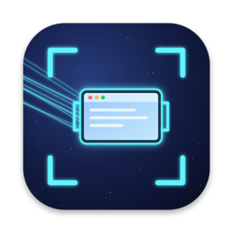
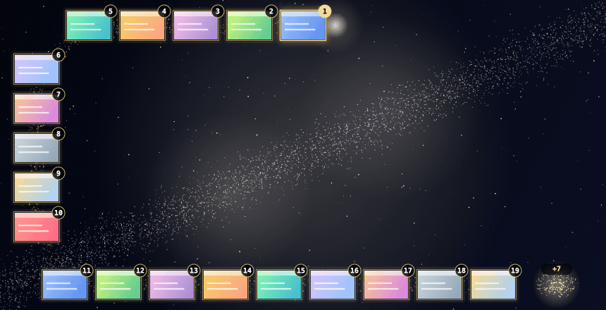

# Clipstar

Your screenshots and copies, docked round the edge of your screen against the Milky Way.

A space-themed fork of [Tendedero](https://github.com/alejandrobujan/tendedero) by [Alejandro Buján](https://github.com/alejandrobujan): all the groundwork is his. See [Credits and thanks](#credits-and-thanks).

Mockup of the layout. Your own screenshots appear on the cards.

## What it does

- **Screenshots and copies dock quietly.** Take a screenshot, or copy an image, an image file in Finder or some text, and it joins the dock straight away. Nothing pops up.
- **Open the dock** with ⌃⌥H, from the menu bar icon, or by resting the pointer next to the icon. The screen turns to space, with the newest card (**1**) at the middle of the top and older ones running left, down the side and along the bottom. The right side stays clear.
- **Many more than fit:** the ones that don't fit wait in a tail of stardust in the bottom right corner, with a count.
- **Slide** along the rail with a sideways two-finger swipe, or the mouse wheel.
- **Zoom** a card up to 2× with an up and down swipe, a pinch, or ⌘ and the wheel. It grows only while you do it; the cards beside it move aside.
- **Click** a card to copy it. It says Copied, and the dock gets out of the way, back to the app you were in, ready to paste. Drag a card into any app or folder, double click to open, hold for Markup, right click for more.
- **iPhone too (optional).** Turn on Dock iPhone copies and whatever you copy on your iPhone docks here through Universal Clipboard, with a little iPhone badge. A two-step Send to Clipstar shortcut on the iPhone brings screenshots and photos as well, through iCloud Drive; iPhone Setup… in the menu shows how.
- **Pin on Top.** Right click a card and pin it: it floats in its own little window over every app, to drag, pinch to zoom and close when you're done.
- **Copied text stays private.** Text shows as asterisks. One **Show text** button asks for Touch ID or your password, and it locks again when the dock closes. Anything a password manager marks as private is never kept.
- **Close** with a click on empty space, Escape or ⌃⌥H.

From the menu: how solid the space background is, card size, which copies to keep, the shortcut, and **Handle screenshots**, which saves screenshots straight to Clipstar without the floating thumbnail (your own settings come back when it quits).

## Build

Needs macOS 14 or later and Swift (the Command Line Tools are enough, no Xcode).

    scripts/build-app.sh
    open build/Clipstar.app

Built without a certificate, the app is signed ad hoc, and macOS asks again for folder access after every rebuild. To keep its answers, make a code signing certificate named `Clipstar Local Signing` in Keychain Access (Certificate Assistant, Create a Certificate, type Code Signing); the build script uses it when it finds it.

## Credits and thanks

Clipstar exists because of **[Tendedero](https://github.com/alejandrobujan/tendedero)** by **[Alejandro Buján](https://github.com/alejandrobujan)**, and all the credit for its foundations goes to him.

Tendedero's idea of hanging your screenshots on a little clothesline at the top of the screen is what got me started. Almost everything that makes Clipstar work comes from his code: watching for new screenshots, handling where macOS saves them, picking up copied images, copy and drag and drop, Markup, Quick Look, the menu bar and the shortcut. Clipstar is his app wearing a space suit. I swapped the clothesline for a dock round the edge of the screen and added a few things on top.

Thank you, Alejandro, for building Tendedero, for sharing it openly, and for the motivation to make something of my own with it. If you like the idea of Clipstar, please go and try the original at [tendedero.app](https://tendedero.app) and give [the Tendedero repository](https://github.com/alejandrobujan/tendedero) a star.

Clipstar is released under the same MIT License as Tendedero, with Alejandro Buján's original copyright notice kept in [LICENSE](LICENSE).
